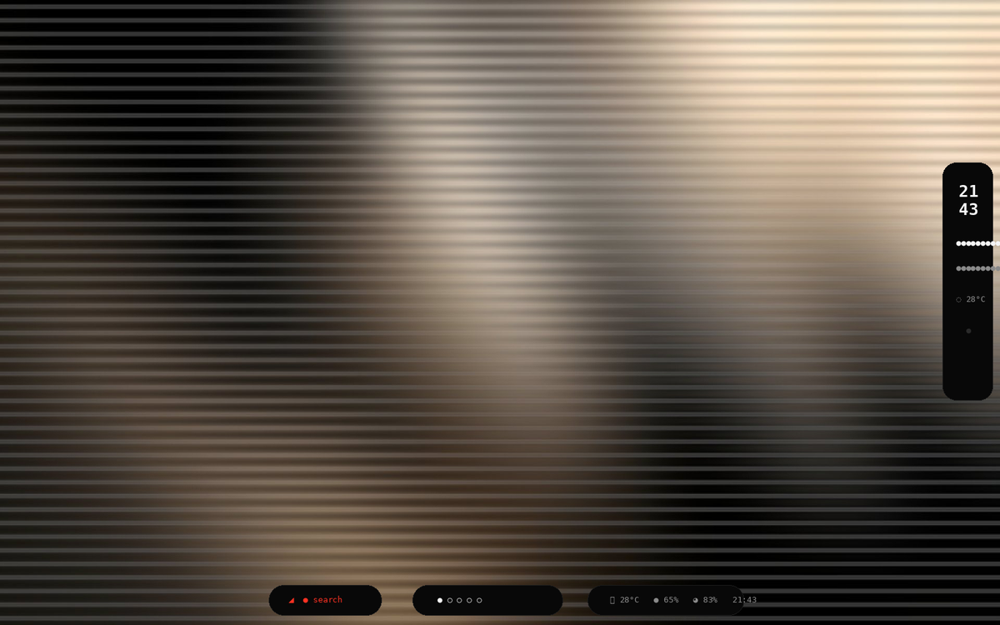
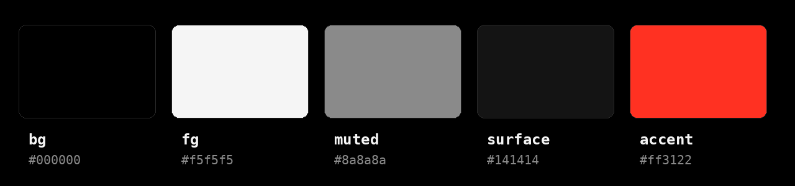

# navairgap's dots

hyprland rice. nothing os inspired — black, white, one red, dots everywhere.



wallpaper is generated by scripts/make-wallpaper.sh, dots and all.

## install

```bash
git clone https://github.com/navairgap/dotfiles ~/dotfiles
cd ~/dotfiles
./scripts/install.sh
```

arch only. installs the packages, backs up your old ~/.config to
~/.config/backup-<date>, symlinks everything, generates the wallpaper.
log out, pick hyprland at your dm, log in.

## keys

| key | what |
| --- | --- |
| super + t | kitty |
| super + r | rofi |
| super + b | firefox |
| super + e | thunar |
| super + q | close |
| super + f | fullscreen |
| super + m | maximize |
| super + arrows | focus |
| super + shift + arrows | move window |
| super + 1..5 / shift+1..5 | workspace / send window |
| super + drag | move window |
| super + right-drag | resize |
| fn volume / brightness | wpctl / brightnessctl |
| super + shift + r | hyprctl reload |

## what's here

hypr/ (main, keys, autostart, rules, colors) · waybar (pill bar + widgets) ·
rofi · kitty · dunst · fastfetch · nothing wallpapers · gtk dark · screenshot helper

## palette



bg `#000000` · fg `#f5f5f5` · muted `#8a8a8a` · surface `#141414` · red `#ff3122`

## known issues / todo

- waybar tray sometimes doesn't come up on first boot. `pkill waybar && waybar &` fixes it. haven't debugged further.
- swww loses the wallpaper after suspend sometimes — just re-run `scripts/make-wallpaper.sh`, it's idempotent.
- bluetooth + pipewire crackle on some headsets. it's pipewire, not the dots. probably.
- screenshots: `scripts/screenshot.sh` (area select, auto-copies) or plain `grim`.
- right-side dot widgets (the NThing look): `waybar -c ~/.config/waybar/widgets.jsonc -s ~/.config/waybar/style.css`. optional, the pill bar is the default.
- todo: steal a better rofi theme. todo: decide if i actually like the gaps_out=10 or if 8 is the truth.
- todo: nvidia laptop owners — set your env vars, you're on your own.

## borrowed from

- keybind layout and the general shape: prasanthrangan/hyprdots
- blur/animation starting point: end-4 — then i made them boring on purpose
- dot workspaces — half of r/unixporn does this, not sure who started it
- wallpapers + JND dot fonts: Runixe786/NThing-UI (rainmeter skin) — personal-use only, go star the original
- reference look: nothing.community "NothingOS inspired desktop setup" thread

## license

mit (see LICENSE)

---
maintained · verified 2026-09-30
---
maintained · verified 2026-10-01
---
maintained · verified 2026-10-02

## Tips

- `super + shift + b` restarts waybar if the tray icons don't appear on first boot.
- re-run `scripts/make-wallpaper.sh` after suspend if swww loses the wallpaper.


## netcheck

`netcheck port host 443 80 22` scans several ports in one run; `-t` sets the connect timeout. exit code 1 if any port is closed — wire it into scripts.


## serveit

`serveit . -p 9000 --no-listing` shares a folder without exposing directory listings. localhost bind by default; `-b 0.0.0.0` only on trusted networks.


## Roadmap

- try out caelestia's dot collection for the shell
- decide gaps 8 vs 10 for good
- package the widgets bar as its own config people can steal


## Getting help

most rice problems are one of three things: stale waybar cache (restart it), lost wallpaper (re-run the generator), or a stale swww socket (kill the daemon, it restarts itself). past that, open an issue with `hyprctl systeminfo` attached.

## Known limitations

- waybar tray icons occasionally don't appear on first boot — restart waybar
- swww can lose the wallpaper across suspend — re-run the generator
- multi-monitor gaps aren't tuned; single-monitor setups look the intended way

## Influences

- end-4 — animation curves; took the bezier, left the rest
- prasanthrangan/hyprdots — keybind layout
- caelestia — shell ideas, not yet adopted

## Keybind reference

| key | action |
| --- | --- |
| super + h/j/k/l | focus |
| super + shift + h/j/k/l | move window |
| super + 1..5 / shift+1..5 | workspace / send |
| super + f / m | fullscreen / maximize |
| super + w | next wallpaper |
| super + shift + b | restart waybar |
| super + q | close |

## Upgrade path

`git pull` in ~/dotfiles picks up changes; re-run `scripts/install.sh` only when new packages or fonts appear in the commit log. your tweaks in `~/.config` survive — the installer never overwrites, it symlinks.

## Non-goals

no widget framework, no distro support beyond arch, no install wizard. three files of shell and symlinks is the whole product.

## Fonts

the JND dot fonts ship in `fonts/` and install to `~/.local/share/fonts` — they came with the NThing-UI rainmeter skin and are personal-use only. JetBrains Mono Nerd Font is the workhorse; the dot fonts are the garnish.

## Maintenance

day-to-day: `git pull` in ~/dotfiles. after pulls that touch `scripts/install.sh`, re-run it — it is idempotent and backs up before linking. when waybar misbehaves, `super+shift+b` before anything else.

## Shell

zsh with a minimal rc — prompt, path, history size, done. a shell you can't retype from memory is a liability.

## History

the rice started life as a windows rainmeter screenshot on nothing.community and became a hyprland setup over one weekend of stubbornness. the community post is credited in the readme; the bugs are original.
